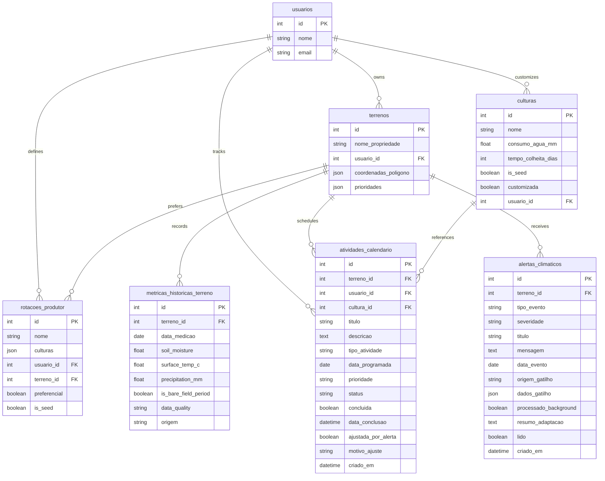
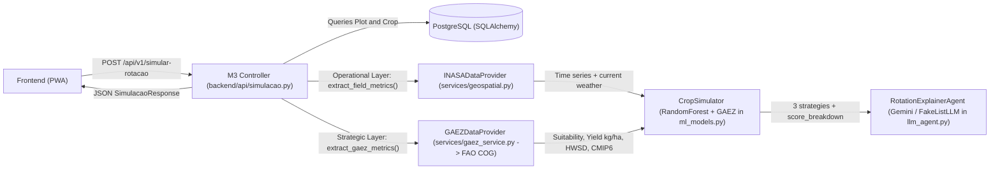

# System Architecture

This document describes the relational database modeling (PostgreSQL/SQLAlchemy) and orchestration across the **Kultiva** API modules.

## 1. Database Modeling (ERD)

> **Modeling note:** The `atividades_calendario` table is mapped by the `Activity` class (`backend/db/models.py`, aliased as `AtividadeCalendario`), allowing direct association with a `Terreno` or `Usuario`, in addition to the textual `status` field (`pendente` / `concluida`) synchronized with `concluida` and `data_conclusao`.

## 2. Two-Layer Geospatial Architecture (Strategic FAO GAEZ v5 + Operational NASA)

To combine long-term structural suitability for Brazilian territory with continuous real-time climate monitoring, the backend separates data collection into two complementary layers:

1. **Strategic Layer (`backend/services/gaez_service.py` — ~10 km / 5 arc-min):**
   - `GAEZDataProvider` **directly** accesses public **FAO GAEZ v5** Cloud-Optimized GeoTIFF (COG) rasters via HTTP Range Requests (`RES05-SUX` / `RES05-YLX` *Suitability and Attainable Yield*, `CMIP6 FP2140 SSP370` projection, `HWSDV201` soil, `SQX.SQ0` quality, `SQ-IDX` limiting factor, and `SLOPE-MED` slope), selecting among the 4 management regimes (`LRLM`, `HRLM`, `LILM`, `HILM`) based on farmer priorities and keeping a local cache in `data/gaez_cache/`.
   - **No fabricated fallbacks policy:** when the GAEZ service is unresponsive, it explicitly returns `data_quality="no_data"` (HTTP `503` in `GET /api/v1/culturas/aptidao-gaez`).
2. **Operational Layer (`backend/services/geospatial.py`):**
   - `INASADataProvider` (`MockNASADataProvider` with simulatable profiles or `RealNASADataProvider` via `data/real/`, Earthdata `SPL3SMP_E`, `ECO2LSTE`, `GPM_3IMERGDF`, `MOD13Q1`, and public **NASA POWER** fallback) provides recent series for soil moisture, surface temperature, precipitation, and bare-field periods.

## 3. Crop & Rotation Simulator Orchestration (M3)

The `backend/api/simulacao.py` controller acts as the synchronous orchestration layer via dependency injection (`Depends`) for the `POST /api/v1/simular-rotacao` endpoint (also exposed at `/api/v1/simulacoes/`):

- **Input Resilience and Flexibility:** The controller accepts either `terreno_id` (fetching from the database) or `coordenadas_poligono` and `prioridades` sent directly in the JSON payload without requiring prior registration. In the NASA operational layer, if NetCDF data or optional packages are unavailable, a safe fallback preserves the JSON contract; the FAO GAEZ v5 layer enriches the simulation only when real COG/cache data is available (`GAEZ_ENABLED=true` or `perfil_climatico="real"`).

## 4. Asynchronous Climate Alerts & Flexible Calendar Flow (M4 & M5)

To keep the containerized environment lean (without requiring an external broker in the current `docker-compose.yml`), `[M5]` alerts use `FastAPI BackgroundTasks` and FastAPI's native `lifespan` in `backend/services/alert_tasks.py` (`lifespan_monitoramento_alertas`), which automatically starts the periodic background scheduler at application startup (configurable via the `ALERT_MONITOR_INTERVAL_HOURS` environment variable, default `6` hours):

### Dynamic Calendar Adaptation Rules
1. **`chuva_intensa` / `tempestade` / `heavy_rain`:**
   - Postpones pending `irrigacao`, `adubacao`, and `pulverizacao` activities within the event window by `dias_adiamento` days (default `2` days).
   - Creates an `inspecao` activity to check post-rain drainage and runoff.
2. **`onda_de_calor` / `seca` / `heatwave` / `drought`:**
   - Escalates the priority of pending `irrigacao` activities in the window to `critica`.
   - Creates an emergency supplemental `irrigacao` and soil thermal protection activity on the event date.
3. **`geada` / `vendaval` / `frost` / `windstorm` (and other extremes):**
   - Postpones pending `plantio` and `adubacao` activities in the window by `dias_adiamento` days.
   - Creates an emergency `manejo` activity for crop protection.
