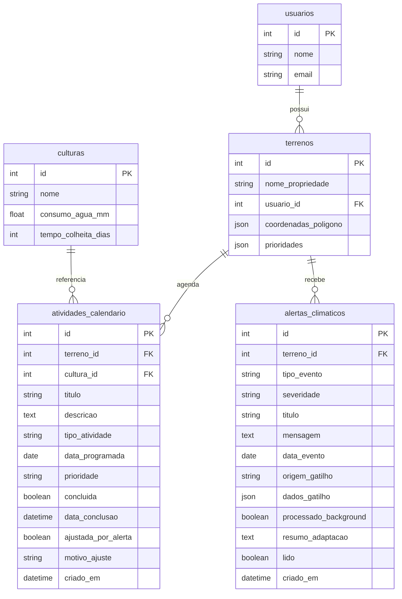
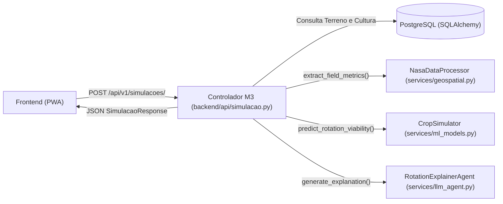
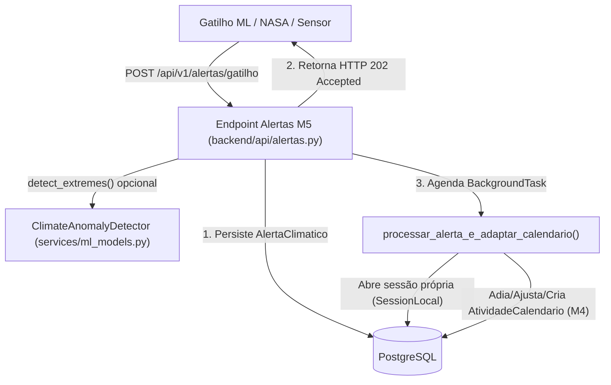

# Arquitetura do Sistema

Este documento descreve a modelagem relacional do banco de dados (PostgreSQL/SQLAlchemy) e a orquestração entre os módulos da API **Kultiva**.

## 1. Modelagem do Banco de Dados (DER)

## 2. Orquestração do Simulador de Culturas e Rotações (M3)

O controlador `backend/api/simulacao.py` atua como camada de orquestração síncrona para a requisição do frontend:

- **Resiliência (Graceful Fallback):** Caso os dados geoespaciais NetCDF ou a chave de API do provedor LLM ainda não estejam disponíveis no ambiente de execução, o controlador aplica fallbacks determinísticos para manter o contrato JSON estável para o frontend.

## 3. Fluxo Assíncrono de Alertas Climáticos e Calendário Maleável (M4 e M5)

Para manter o ambiente containerizado enxuto (sem necessidade de broker externo no `docker-compose.yml` atual), os alertas `[M5]` utilizam `FastAPI BackgroundTasks` encapsuladas em `backend/services/alert_tasks.py`:

### Regras de Adaptação Dinâmica do Calendário
1. **`chuva_intensa` / `tempestade` / `heavy_rain`**:
   - Adia atividades pendentes de `irrigacao`, `adubacao` e `pulverizacao` na janela do evento em `dias_adiamento` dias (padrão `2` dias).
   - Cria atividade de `inspecao` para verificação de drenagem e escoamento pós-chuva.
2. **`onda_de_calor` / `seca` / `heatwave` / `drought`**:
   - Eleva a prioridade de atividades pendentes de `irrigacao` na janela para `critica`.
   - Cria atividade emergencial de `irrigacao` suplementar e proteção térmica do solo na data do evento.
3. **`geada` / `vendaval` / `frost` / `windstorm` (e demais extremos)**:
   - Adia atividades pendentes de `plantio` e `adubacao` na janela em `dias_adiamento` dias.
   - Cria atividade de `manejo` emergencial para proteção da lavoura.
