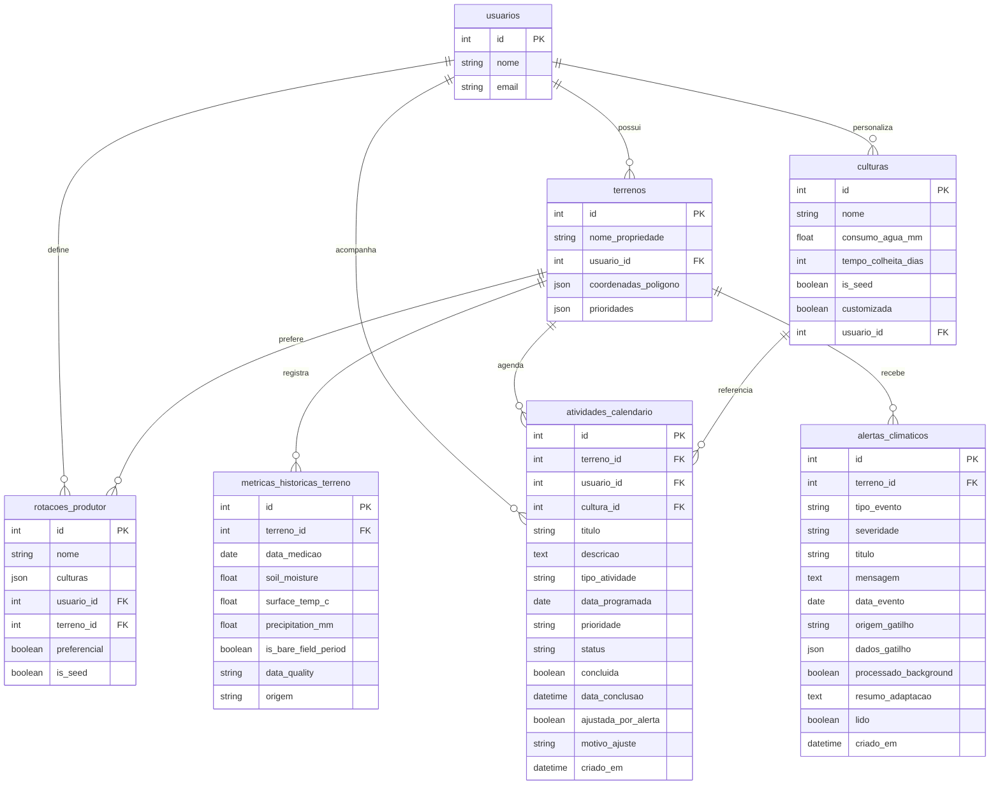
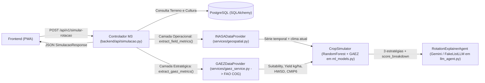
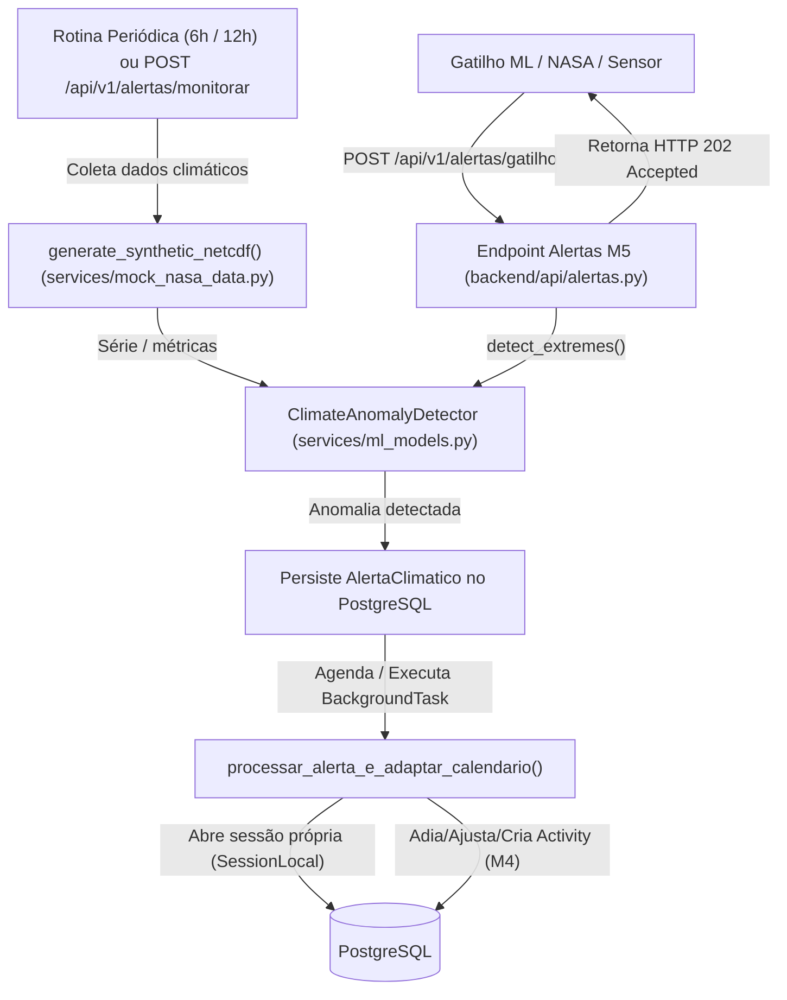

# Arquitetura do Sistema

Este documento descreve a modelagem relacional do banco de dados (PostgreSQL/SQLAlchemy) e a orquestração entre os módulos da API **Kultiva**.

## 1. Modelagem do Banco de Dados (DER)

> **Nota de modelagem:** A tabela `atividades_calendario` é mapeada pela classe `Activity` (`backend/db/models.py`, com alias `AtividadeCalendario`) permitindo vínculo direto a um `Terreno` ou `Usuario`, além do campo textual `status` (`pendente` / `concluida`) sincronizado com `concluida` e `data_conclusao`.

## 2. Arquitetura Geoespacial em 2 Camadas (Estratégica FAO GAEZ v5 + Operacional NASA)

Para unir adequação estrutural de longo prazo ao território brasileiro com monitoramento climático contínuo em tempo real, o backend separa a coleta de dados em duas camadas complementares:

1. **Camada Estratégica (`backend/services/gaez_service.py` — ~10 km / 5 arc-min):**
   - `GAEZDataProvider` acessa **diretamente** via HTTP Range Requests os rasters Cloud-Optimized GeoTIFF (COG) públicos do **FAO GAEZ v5** (`RES05-SUX` / `RES05-YLX` *Suitability and Attainable Yield*, projeção `CMIP6 FP2140 SSP370`, solo `HWSDV201`, qualidade `SQX.SQ0`, fator limitante `SQ-IDX` e declividade `SLOPE-MED`), escolhendo entre os 4 regimes de manejo (`LRLM`, `HRLM`, `LILM`, `HILM`) pelas prioridades do produtor e mantendo cache local em `data/gaez_cache/`.
   - **Política sem fallbacks inventados:** quando o serviço GAEZ não responde, retorna explicitamente `data_quality="no_data"` (HTTP `503` em `GET /api/v1/culturas/aptidao-gaez`).
2. **Camada Operacional (`backend/services/geospatial.py`):**
   - `INASADataProvider` (`MockNASADataProvider` com perfis simuláveis ou `RealNASADataProvider` via `data/real/`, Earthdata `SPL3SMP_E`, `ECO2LSTE`, `GPM_3IMERGDF`, `MOD13Q1` e fallback público **NASA POWER**) fornece séries recentes de umidade, temperatura superficial, precipitação e solo descoberto.

## 3. Orquestração do Simulador de Culturas e Rotações (M3)

O controlador `backend/api/simulacao.py` atua como camada de orquestração síncrona via injeção de dependências (`Depends`) para o endpoint `POST /api/v1/simular-rotacao` (também exposto em `/api/v1/simulacoes/`):

- **Resiliência e Flexibilidade de Entrada:** O controlador aceita tanto `terreno_id` (buscando no banco) quanto `coordenadas_poligono` e `prioridades` enviados diretamente no JSON sem exigir cadastro prévio. Na camada operacional NASA, caso dados NetCDF ou pacotes opcionais não estejam disponíveis, aplica fallback seguro para manter o contrato JSON estável; já a camada FAO GAEZ v5 só enriquece a simulação quando os dados reais do COG/cache estão disponíveis (`GAEZ_ENABLED=true` ou `perfil_climatico="real"`).

## 4. Fluxo Assíncrono de Alertas Climáticos e Calendário Maleável (M4 e M5)

Para manter o ambiente containerizado enxuto (sem necessidade de broker externo no `docker-compose.yml` atual), os alertas `[M5]` utilizam `FastAPI BackgroundTasks` e o ciclo de vida (`lifespan`) nativo do FastAPI em `backend/services/alert_tasks.py` (`lifespan_monitoramento_alertas`), que inicia automaticamente o agendador periódico em segundo plano no startup da aplicação (configurável via variável de ambiente `ALERT_MONITOR_INTERVAL_HOURS`, padrão `6` horas):

### Regras de Adaptação Dinâmica do Calendário
1. **`chuva_intensa` / `tempestade` / `heavy_rain`**:
   - Adia atividades pendentes de `irrigacao`, `adubacao` e `pulverizacao` na janela do evento em `dias_adiamento` dias (padrão `2` dias).
   - Cria atividade de `inspecao` para verificação de drenagem e escoamento pós-chuva.
2. **`onda_de_calor` / `seca` / `heatwave` / `drought`**:
   - Eleva a prioridade de atividades pendentes de `irrigacao` na janela para `critica`.
   - Cria atividade emergencial de `irrigacao` suplementar e proteção térmica do solo na data do evento.
3. **`geada` / `vendaval` / `frost` / `windstorm` (e demais extremos)**:
   - Adia atividades pendentes de `plantio` e `adubacao` na janela em `dias_adiamento` dias.
   - Cria atividade de `manejo` emergencial para proteção da lavoura.
